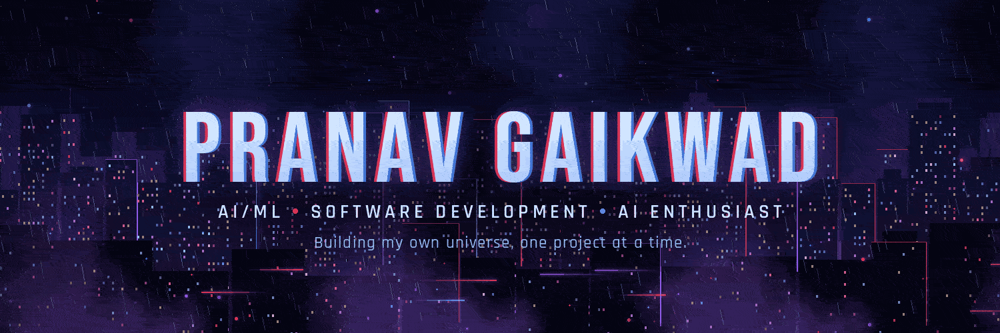

<!-- ===================================================== -->
<!-- PRANAV GAIKWAD | SPIDER-VERSE INSPIRED GITHUB PROFILE -->
<!-- THEME: BLACK • RED • WHITE -->
<!-- ===================================================== -->

  

# PRANAV GAIKWAD

### COMPUTER SCIENCE & ENGINEERING | AI & ML

**Developer · AI/ML Explorer · Creative Problem Solver**

*Building my own universe, one project at a time.*

📍 Pune, Maharashtra, India

---

<h2 align="center">
  
</h2>

Hey! I'm <strong>Pranav Gaikwad</strong>, a second-year B.Tech student pursuing Computer Science and Engineering with a specialization in Artificial Intelligence and Machine Learning at <strong>MIT Academy of Engineering (MITAOE), Pune</strong>.

I'm someone who enjoys exploring the intersection of technology, creativity, and problem-solving. From experimenting with AI-powered applications to developing software products and participating in hackathons, I love turning ideas into something meaningful.

My journey is driven by curiosity and the desire to build things that solve real-world problems.

<ul>
  <li>Exploring Artificial Intelligence, Machine Learning and Generative AI.</li>
  <li>Developing software applications and exploring full-stack technologies.</li>
  <li>Experimenting with computer vision, automation and intelligent systems.</li>
  <li>Participating in hackathons, competitions and collaborative projects.</li>
  <li>Interested in product development, startups and emerging technologies.</li>
  <li>Also passionate about creative design, branding and visual storytelling.</li>
</ul>

<h3 align="center">
  
</h3>

  <strong>Learn something new. Build something useful. Improve every day.</strong>

---

<h2 align="center">
  
</h2>

### Programming Languages

### AI / Machine Learning

### Frontend Development

### Backend Development

### Databases

### Cloud & Deployment

### DevOps & Tools

### Creative & Analytics

### Optimization & Operations Research

`CP-SAT` · `Constraint Optimization`

---

<h2 align="center">
  
</h2>

I enjoy working on projects that combine technology with practical problem-solving.

### Featured Development Projects

<table width="100%">
  <tr>
    <td width="30%">
      <h3>01. PROOF</h3>
      
    </td>
    <td>
      Evidence-driven AI coding assessment platform focused on evaluating the developer's problem-solving process, not just final code.
    </td>
  </tr>
  <tr>
    <td>
      <h3>02. SwasthyaNet</h3>
      
    </td>
    <td>
      AI-enabled rural healthcare concept focused on improving access to preliminary health guidance.
    </td>
  </tr>
  <tr>
    <td>
      <h3>03. SafeRide AI</h3>
      
    </td>
    <td>
      Computer vision-based helmet detection and road safety project.
    </td>
  </tr>
  <tr>
    <td>
      <h3>04. Sanjeevani</h3>
      
    </td>
    <td>
      Humanitarian-focused project.
    </td>
  </tr>
</table>

### Other Projects & Explorations

- **SmartParks** — Smart parking management system concept.
- **MindGuard AI** — Mental wellness-oriented mood classification concept.
- **Animal Detection System** — Animal detection and information using computer vision.
- **FoodBridge** — Connecting surplus food providers with organizations.
- **The Last-Mile Spoilage Trap** — Exploring better coordination of perishable aid delivery.
- **3D-Printed Cable Organizer** — Product design and prototyping.
- **Biodegradable Plant Pots** — Sustainable material and product experimentation.
- **AI-Based Document Screening** — Exploring identity and document verification.
- **AI Hypoglycemia Prediction** — Healthcare-focused hackathon concept.

<i>Project descriptions and implementation status will be refined against each repository before being treated as final.</i>

---

<h2 align="center">
  
</h2>

- 🏆 **Winner — MITAOE First-Year Logo Design Competition**
  - Winning design selected as the official Student Association of AIML logo.
- 🎓 **Cisco Virtual Internship**
  - Completed in October 2026.

---

<h2 align="center">
  
</h2>

- **ASTRA** — CSE (AI/ML) Student Association.
- **AAAI Student Chapter** — Student community involvement.
- **AlgoVeda** — Technical community and learning.

I enjoy contributing to student activities, creative branding, design, and collaborative initiatives.

---

<h2 align="center">
  
</h2>

  

  

---

<h2 align="center">
  
</h2>

- Deepening my AI/ML foundations.
- Building more complete full-stack applications.
- Exploring Generative AI and intelligent agents.
- Learning cloud infrastructure and scalable systems.
- Collaborating on meaningful open-source and hackathon projects.

---

<h2 align="center">
  
</h2>

**Instagram · LinkedIn · GitHub · LeetCode**

 

*Building. Learning. Creating my own universe.*

<!-- ===================================================== -->
<!-- END OF README -->
<!-- ===================================================== -->
